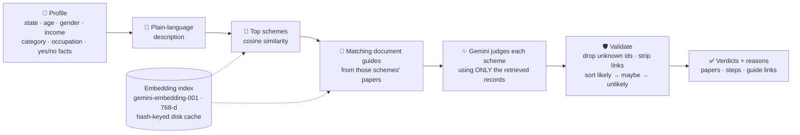
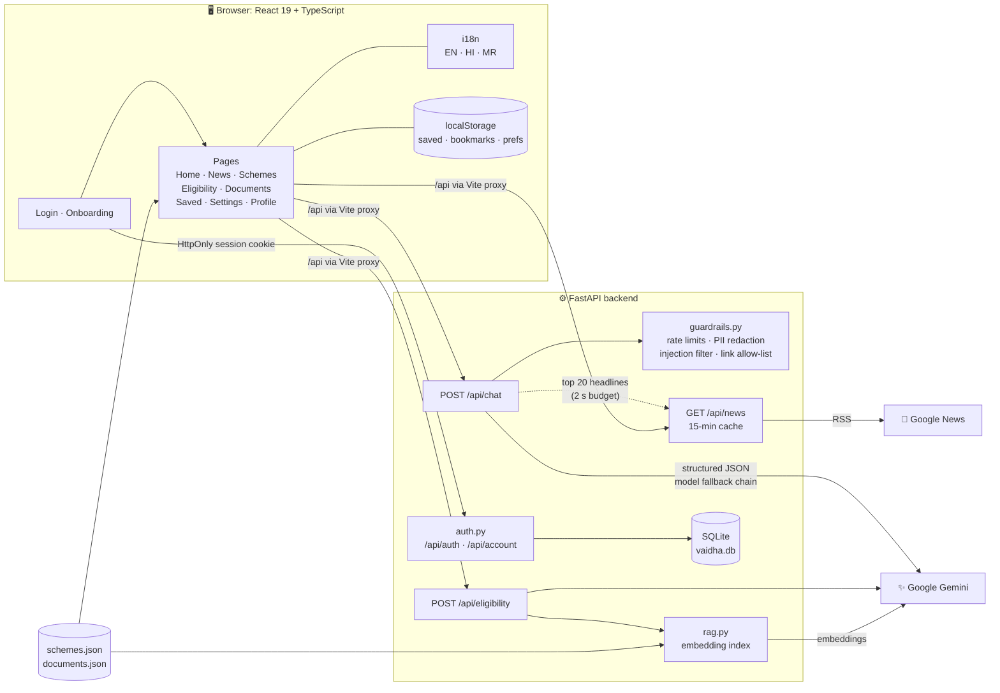
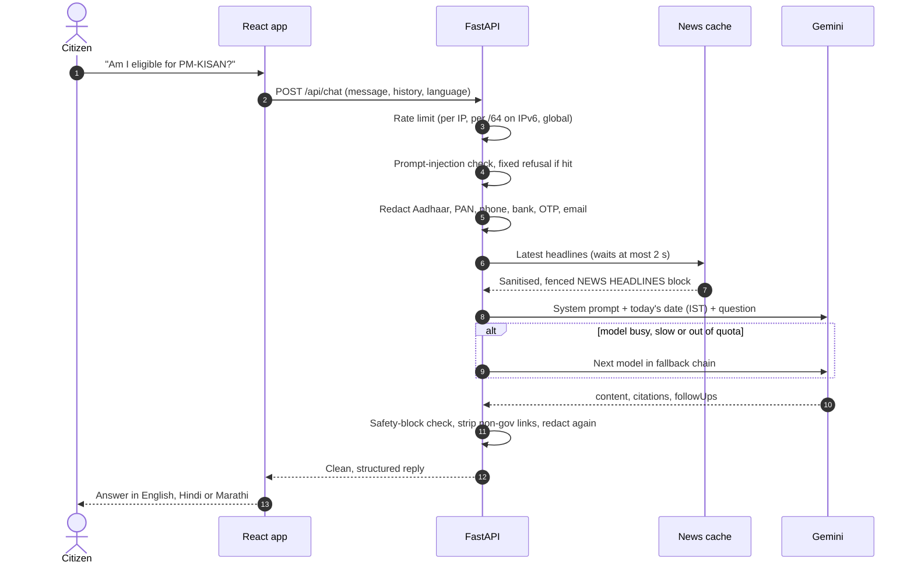

<div align="center">


# Vaidha AI

### Virtual Assistant for Indian Documentation & High-level Administration

**Government schemes, eligibility and paperwork, explained in plain words, in your language.**

<br />

[](https://react.dev)
[](https://www.typescriptlang.org)
[](https://vite.dev)
[](https://fastapi.tiangolo.com)
[](https://www.python.org)
[](https://ai.google.dev)
[](https://sqlite.org)


[**The problem**](#-the-problem) · [**Features**](#-features) · [**RAG eligibility**](#-rag-eligibility-engine) · [**Architecture**](#-architecture) · [**Safety**](#-safety--guardrails) · [**Quick start**](#-quick-start) · [**API**](#-api-reference) · [**Roadmap**](#-roadmap)

</div>

---

## 🪔 The problem

India runs **hundreds of welfare schemes** across central and state governments. The people they are meant for (farmers, students, elderly citizens, first-time applicants) often can't find them, can't tell if they qualify, and don't know which papers to bring. The information exists, but it is spread across dozens of portals, written in official language, and mostly in English.

**Vaidha** is one conversational front door to all of it:

> *"I'm a farmer in Maharashtra earning under 3 lakh a year. What can I apply for, and what documents do I need?"*

Vaidha answers in **English, Hindi or Marathi**, in plain language, points only to **official `gov.in` / `nic.in` portals**, and never lets personal data like Aadhaar numbers reach the AI model.

---

## ✨ Features

<table>
<tr>
<td width="50%" valign="top">

### 💬 Chat-first assistant
Ask anything about schemes, eligibility or documents. Answers come back as structured JSON from Gemini (content, official citations, suggested follow-ups) and render as clean headings, lists and links.

</td>
<td width="50%" valign="top">

### 🗞️ Live government news
Headlines from Google News RSS across six categories (Central Government, Maharashtra, Education, Healthcare, Agriculture, Employment), auto-tagged as *Deadline*, *Eligibility Change*, *Scheme Update* and more. Cached for 15 minutes.

</td>
</tr>
<tr>
<td valign="top">

### 📅 Knows what day it is
Every chat carries today's date in IST and the 20 newest headlines, so the model can flag expired deadlines and recent policy changes instead of relying on stale training data.

</td>
<td valign="top">

### 🏛️ Explore Schemes
A hand-verified catalogue of **16 central and Maharashtra schemes** (PM-KISAN, Ayushman Bharat PM-JAY, Majhi Ladki Bahin, PM-Surya Ghar, MUDRA and more), each with benefits, eligibility and a link to its official portal.

</td>
</tr>
<tr>
<td valign="top">

### ✅ Eligibility Checker
Fill in a short profile and get a **likely / maybe / unlikely** verdict for each matching scheme, with the reason, what to confirm, the papers you need and the steps to apply, all grounded in Vaidha's verified data ([how it works](#-rag-eligibility-engine)).

</td>
<td valign="top">

### 📄 Document Library
Step-by-step guides for **27 documents you can apply for online**: Aadhaar, PAN, passport, caste and income certificates, 7/12 extract, Udyam, GST, FSSAI and more. Each lists the issuing body, official portal, who can apply, papers needed and a practical tip.

</td>
</tr>
<tr>
<td valign="top">

### 🌐 Fully trilingual
Every button, label, prompt and document guide is translated into **हिन्दी** and **मराठी**, and the AI answers in the language you picked.

</td>
<td valign="top">

### ♿ Built for everyone
Adjustable text size for elderly users, a mobile drawer layout under 768px and keyboard-accessible modals.

</td>
</tr>
<tr>
<td valign="top">

### 🔑 Private accounts
Sign up with an Indian mobile number and password, then a one-time onboarding (name, age, state, district, language). Accounts live in a local SQLite database; nothing is sent to an outside service.

</td>
<td valign="top">

### 🔖 Your own workspace
Saved schemes, bookmarked news and your profile stay with you, and your language choice follows your account across sessions.

</td>
</tr>
</table>

---

## 🎯 RAG eligibility engine

Asking a language model "which schemes am I eligible for?" invites made-up schemes and wrong amounts. Vaidha's checker uses **retrieval-augmented generation**: the model may only judge schemes it is handed from the verified data, and only using those records.



| Step | Detail |
|---|---|
| **One source of truth** | Schemes and document guides live in `frontend/src/data/schemes.json` and `documents.json`. The UI imports them and the backend indexes the same files, so the two can never drift apart. |
| **Embedding** | Each scheme and guide becomes one text chunk, embedded with `gemini-embedding-001` at 768 dimensions and normalised. Vectors are cached in `backend/.cache/embeddings.json` keyed by a hash of the text, so only new or edited entries are re-embedded, and the index rebuilds itself when the JSON changes. |
| **Retrieval** | Plain cosine similarity over all vectors: the corpus is tens of entries, so a vector database would only add moving parts. Maharashtra-only schemes are filtered out for other states. |
| **Two-hop retrieval** | After finding the schemes, Vaidha retrieves the document guides closest to *those schemes' required papers*, so every verdict can link straight to "how to get this document". |
| **Grounded judging** | Gemini returns structured JSON (`verdict`, `reason`, `toConfirm`, `papers`, `documentIds`, `steps`). Every fact in the profile is stated explicitly, including negatives like *does not own a pucca house*, so the model can't assume them. |
| **Trust but verify** | Any scheme or document id the model returns that wasn't retrieved is dropped. Results are sorted by verdict, then by relevance. |

---

## 🧩 Architecture



### Life of a question

Every message passes through a defence-in-depth pipeline before and after it touches the model:



### Design decisions

| Decision | Why |
|---|---|
| **Structured output** (`ChatReply` schema) | The UI gets guaranteed `content` / `citations` / `followUps` fields, with no fragile text parsing. |
| **Model fallback chain** | Each Gemini model has its own free-tier quota. If one is overloaded, times out or hits 429, the next answers. SDK retries are disabled so failover is fast. |
| **Headlines in the user turn, not the system prompt** | News comes from outside publishers, so it is treated as *untrusted data*: flattened to one line, injection-filtered and fenced off, never given system-level authority. |
| **2-second news budget** | A slow RSS feed never slows down a chat; the answer simply goes out without headlines. |
| **Escaped markdown subset** | `MessageBubble` HTML-escapes model output before adding only `<strong>` and `<a>`, so the model can't inject markup. |
| **No vector database** | Tens of documents fit in memory; cosine similarity in a few lines of Python beats running and securing another service. |
| **Local SQLite for accounts** | Phone numbers and profiles never leave the server, and there is nothing extra to deploy. |
| **No router, no state library** | A single `App.tsx` owns state and pages hand off to each other (and to the chat) through callbacks. Small surface, zero extra dependencies. |
| **Translation keys are the English text** | `t('English text')` reads like normal code, and a missing translation falls back to English instead of breaking. |

---

## 🔐 Safety & guardrails

Government services attract vulnerable users and sensitive data. Vaidha treats both seriously.

| Layer | What it does | Where |
|---|---|---|
| 🔒 **PII redaction** | Aadhaar, PAN, IFSC, phone, bank/card numbers, OTP/PIN and email are replaced with placeholders *before* reaching Gemini **and** on the way back. The model only ever sees `[Aadhaar number removed]`. | `guardrails.py` |
| 🧱 **Prompt-injection filter** | Known jailbreak patterns ("ignore previous instructions", "developer mode", …) get a fixed refusal without calling the model. Poisoned history turns are dropped. | `guardrails.py` |
| 🔗 **Official-link allow-list** | Only `https` links to `gov.in`, `nic.in`, `mygov.in`, `india.gov.in`, `rbi.org.in`, `npci.org.in` (and subdomains) stay clickable. | `guardrails.py` |
| ⏱️ **Rate limiting** | Chat: 10/min and 150/day per visitor. Eligibility: 5/min and 60/day. Both share a 30/min global cap to protect quota. Logins are limited per number and per visitor. IPv6 visitors are grouped per `/64`, memory is capped at 100k tracked keys, and every limit answers `429` with `Retry-After`. | `guardrails.py`, `main.py`, `auth.py` |
| 🔑 **Account security** | Passwords (8+ characters) hashed with **scrypt** and a per-user salt. Session tokens are random, sent in an `HttpOnly` cookie, and stored only as SHA-256 hashes. A wrong password and an unknown number get the same message and the same timing, so attackers can't discover which numbers are registered. | `auth.py` |
| 🚫 **Gemini safety settings** | Harassment, hate, sexual and dangerous content blocked at medium and above. | `main.py` |
| 📜 **Grounded system prompt** | Never invent schemes, amounts or deadlines; say when unsure and point to the official source; stay politically neutral. | `main.py` |

The guardrails ship with a runnable self-check:

```bash
cd backend
.venv/Scripts/python guardrails.py   # Windows
.venv/bin/python guardrails.py       # macOS / Linux
```

---

## 🚀 Quick start

### Prerequisites

- **Node.js** 22+ and npm
- **Python 3.12** and [`uv`](https://docs.astral.sh/uv/)
- A free **Gemini API key** from [Google AI Studio](https://aistudio.google.com/apikey)

### 1. Backend

```bash
cd backend
uv venv --python 3.12 .venv
uv pip install -r requirements.txt
cp .env.example .env          # then paste your key into GEMINI_API_KEY
```

Start it:

```bash
.venv/Scripts/uvicorn main:app --reload --port 8000   # Windows
.venv/bin/uvicorn main:app --reload --port 8000       # macOS / Linux
```

### 2. Frontend

In a second terminal:

```bash
cd frontend
npm install
npm run dev
```

Open **http://localhost:5173**, register with a mobile number and password, and you're in. Vite proxies every `/api/*` call to the backend on port 8000.

> The backend creates `backend/vaidha.db` (accounts) and `backend/.cache/embeddings.json` (RAG index) on first use. Both are git-ignored.

### Useful commands

| Command | Where | What |
|---|---|---|
| `npm run dev` | `frontend/` | Dev server with hot reload |
| `npm run build` | `frontend/` | Type check (`tsc -b`) + production build |
| `npm run lint` | `frontend/` | Lint with [oxlint](https://oxc.rs) |
| `npm run preview` | `frontend/` | Serve the production build |
| `python guardrails.py` | `backend/` | Guardrails self-test |

### Configuration

| Variable | Default | Purpose |
|---|---|---|
| `GEMINI_API_KEY` | *(required)* | Your Google AI Studio key |
| `GEMINI_MODEL` | `gemini-3.1-flash-lite` | First model tried |
| `GEMINI_FALLBACK_MODELS` | `gemini-3.6-flash,gemini-3.5-flash` | Tried in order when the previous one fails |
| `GEMINI_EMBED_MODEL` | `gemini-embedding-001` | Embedding model for the RAG index |
| `VAIDHA_DB` | `backend/vaidha.db` | SQLite database for accounts and sessions |
| `VAIDHA_DATA_DIR` | `frontend/src/data` | Where `schemes.json` and `documents.json` are read from |

---

## 📡 API reference

<details>
<summary><b><code>POST /api/chat</code></b>: ask Vaidha a question</summary>

<br />

**Request**

```json
{
  "message": "What documents do I need for a ration card?",
  "history": [
    { "role": "user", "content": "Hi" },
    { "role": "assistant", "content": "Hello! How can I help?" }
  ],
  "language": "Hindi"
}
```

| Field | Type | Limits |
|---|---|---|
| `message` | string | 1 to 4000 chars |
| `history` | `{role, content}[]` | up to 50 turns (last 10 used) |
| `language` | `"English"`, `"Hindi"` or `"Marathi"` | default `English` |

**Response**

```json
{
  "content": "### Ration card documents\n\n1. **Aadhaar card** ...",
  "citations": [
    { "title": "National Food Security Act", "department": "Dept. of Food & Public Distribution", "documentType": "Act" }
  ],
  "followUps": ["How do I apply online in Maharashtra?", "Can I add a family member later?"]
}
```

**Errors:** `429` rate limited (with `Retry-After`) · `502` Gemini error · `503` all models busy or key missing

</details>

<details>
<summary><b><code>POST /api/eligibility</code></b>: RAG eligibility check</summary>

<br />

**Request**

```json
{
  "profile": {
    "state": "Maharashtra", "age": 42, "gender": "Male",
    "income": "1l-3l", "category": "OBC", "occupation": "farmer",
    "ownsFarmland": true, "ownsPuccaHouse": false, "hasDisability": false,
    "pregnantOrNewMother": false, "paysIncomeTax": false
  },
  "language": "Marathi"
}
```

**Response**

```json
{
  "summary": "Two schemes look likely for you. Start with PM-KISAN on the official portal.",
  "results": [
    {
      "schemeId": "pm-kisan",
      "verdict": "likely",
      "reason": "You own farmland and do not pay income tax.",
      "toConfirm": ["Land records are in your name"],
      "papers": ["Aadhaar card", "7/12 extract", "Bank passbook"],
      "documentIds": ["aadhaar", "satbara"],
      "steps": ["Open the PM-KISAN portal", "Choose New Farmer Registration", "..."]
    }
  ]
}
```

*Example values are illustrative.*

</details>

<details>
<summary><b><code>/api/auth/*</code> and <code>/api/account</code></b>: accounts and sessions</summary>

<br />

| Method | Path | Purpose |
|---|---|---|
| `POST` | `/api/auth/register` | Create an account (`phone`, `password`) and start a session |
| `POST` | `/api/auth/login` | Log in, sets the `vaidha_session` cookie (30 days) |
| `GET` | `/api/auth/me` | Current account, or `null` when logged out |
| `POST` | `/api/auth/logout` | End the session |
| `PUT` / `PATCH` | `/api/account` | Save onboarding details, or update fields such as language |

</details>

<details>
<summary><b><code>GET /api/news</code></b>: live government headlines</summary>

<br />

Returns news items from six category searches, cached in memory for 15 minutes. Each item carries `id`, `title`, `summary`, `category`, `authority`, `publishedAt`, `updateType` and `sourceUrl`.

</details>

<details>
<summary><b><code>GET /api/health</code></b>: service status</summary>

<br />

```json
{ "ok": true, "models": ["gemini-3.1-flash-lite", "gemini-3.6-flash", "gemini-3.5-flash"], "keyConfigured": true }
```

</details>

---

## 📁 Project structure

```text
VaidhaAI/
├── backend/
│   ├── main.py                  # FastAPI app: chat, eligibility, news, health, Gemini fallback chain
│   ├── rag.py                   # Embedding index + cosine retrieval over schemes.json / documents.json
│   ├── auth.py                  # Mobile + password accounts, scrypt hashing, sessions (SQLite)
│   ├── guardrails.py            # Rate limits, PII redaction, injection filter, link allow-list (+ self-test)
│   ├── requirements.txt
│   └── .env.example
│
└── frontend/
    ├── vite.config.ts           # Proxies /api → http://127.0.0.1:8000
    ├── public/assets/           # Discovery-card photos and document illustrations
    └── src/
        ├── App.tsx              # All app state, tab switching, responsive shell, chat handler
        ├── i18n.ts              # LanguageContext, useT(), useFormatDate()
        ├── translations.ts      # English → [Hindi, Marathi] for the whole UI
        ├── pages/
        │   ├── Login.tsx              # Register / log in with mobile number + password
        │   ├── Onboarding.tsx         # One-time profile: name, age, state, district, language
        │   ├── Home.tsx               # Chat workspace
        │   ├── NewsUpdates.tsx        # Live headlines, filters, bookmarks
        │   ├── ExploreSchemes.tsx     # Scheme catalogue + detail modal
        │   ├── EligibilityChecker.tsx # Profile form + RAG verdict cards
        │   ├── DocumentLibrary.tsx    # 27 document guides
        │   ├── SavedSchemes.tsx
        │   ├── MyProfile.tsx
        │   └── Settings.tsx           # Language, text size
        ├── components/          # Sidebar, ChatHeader, ChatComposer, MessageBubble, WelcomeScreen, AuthLayout, …
        ├── data/
        │   ├── schemes.json           # 16 verified schemes  ─┐ shared with the backend
        │   ├── documents.json         # 27 document guides   ─┘ (single source of truth)
        │   ├── schemes.ts / documents.ts # TypeScript types over the JSON
        │   └── documentTranslations.ts# Hindi / Marathi guides (type-checked: every document needs both)
        └── utils/
            ├── chatApi.ts             # askVaidha(): never throws, errors become chat messages
            ├── eligibilityApi.ts
            ├── authApi.ts
            ├── newsService.ts
            └── textSize.ts
```

---

## 🧭 Roadmap

- [x] Chat-first UI with image discovery cards and quick prompts
- [x] Gemini backend with structured output and model failover
- [x] Guardrails: PII redaction, injection filter, rate limits, official-link allow-list
- [x] Live government news feed, fed into chat context
- [x] Full Hindi and Marathi translation
- [x] Verified scheme catalogue and 27-document library
- [x] RAG eligibility engine grounded in the verified data
- [x] Mobile number + password accounts with onboarding
- [ ] Deterministic rule checks to cross-verify the AI's verdicts
- [ ] "Forgot password" via SMS or email verification
- [ ] Session checks on the chat, eligibility and news APIs (login is currently enforced by the UI)
- [ ] Search grounding on official portals for always-current scheme facts
- [ ] DigiLocker and UMANG integrations
- [ ] More Indian languages (Tamil, Telugu, Bengali, Gujarati, …)
- [ ] Voice input and read-aloud answers for low-literacy users
- [ ] Shared rate limiting (Redis) for multi-worker deployments

---

## ⚠️ Disclaimer

Vaidha is an informational assistant, **not an official government service**. Scheme rules, amounts and deadlines change; always confirm on the official portal or at your nearest Common Service Centre before applying. Never share Aadhaar numbers, OTPs or bank details with any chatbot, including this one.

<div align="center">

<br />


**Made with care for the citizens of India 🇮🇳**

</div>
